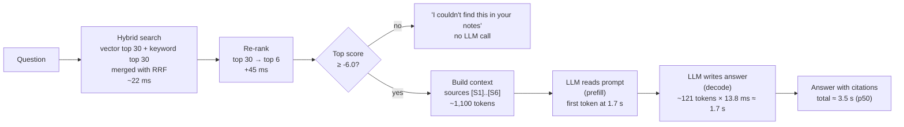
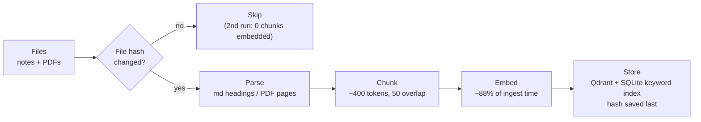

# Source notes: Building and measuring a RAG pipeline, layer by layer (Phases 0–4)

Use this file as the single source of truth for:
1. **Images** (give section 9 to ChatGPT image generation).
2. **LinkedIn posts** (give the whole file to the post-writing skill).

Every number here comes from `results/RESULTS.md` and the trace files. Don't round differently, and don't add numbers that aren't here.

---

## 1. One-line summary

I built a RAG pipeline from scratch on a laptop, added one layer per phase, and measured each layer. Hybrid search made results *worse* than keyword search alone. The re-ranker mostly earned its place by enabling "I don't know". And the answer eval caught a bug that my retrieval metric was hiding.

**Possible hooks**
- "Hybrid search made my RAG worse. Here's the data."
- "My best RAG metric was lying to me."
- "I measured every layer of a RAG pipeline. Only some of them helped."

---

## 2. Setup

| Part | Choice |
|---|---|
| Machine | MacBook, Apple M4 Max (546 GB/s memory bandwidth) |
| Corpus | 26 lecture-note files (markdown) + 3 arXiv papers (PDF): Attention Is All You Need, RAG (Lewis 2020), PagedAttention/vLLM |
| Chunks | 3,017 chunks, ~400 tokens each, 50-token overlap, split at headings and paragraphs |
| LLM | Llama 3.1 8B (Q4_K_M, 4.9 GB) on Ollama, temperature 0 |
| Embeddings | nomic-embed-text (768 dimensions) on Ollama |
| Vector DB | Qdrant (Docker) |
| Keyword search | SQLite FTS5 (BM25) |
| Re-ranker | cross-encoder/ms-marco-MiniLM-L-6-v2 |
| Framework | None, plain Python, so every step is visible |
| Eval set | 24 questions with known answer files (15 use the notes' exact jargon, 9 use everyday words) + 4 off-topic questions the notes can't answer |

---

## 3. Pipeline diagrams

### 3a. Query pipeline (main diagram)

Plain-text version of the same flow:
Question → Hybrid search (~22 ms) → Re-rank 30→6 (+45 ms) → Score check (below -6.0 means "not found", no LLM call) → Build context (~1,100 tokens) → LLM reads prompt (first token at 1.7 s) → LLM writes answer (~1.7 s) → Answer with [S#] citations (≈3.5 s total, median).

Where the time goes (median question): about 2% search + re-rank, about 49% reading the prompt, about 49% writing the answer. **The LLM is ~98% of the wait.**

### 3b. Ingestion pipeline (optional second diagram)

---

## 4. Phase by phase

### Phase 0: Tracing first
- **Added:** each request writes one trace line (JSON, shaped like OpenTelemetry) with the time of every step and a hash of the config.
- **Why it matters:** every number in this file comes from those traces. Results from different settings are never mixed up, because each one carries its config hash.

### Phase 1: Ingestion
- **Added:**
  - parse markdown and PDFs (PDF headers and footers removed)
  - heading-aware chunking
  - embedding, then storing in Qdrant and the SQLite keyword index
  - only new or changed files are processed (file hash check)
- **Results:**
  - Second run: **0 chunks embedded** (nothing changed).
  - Editing one note re-embeds only that note.
  - A broken PDF is marked failed and retried later.
  - All three stores agree on 3,017 chunks.
  - **Embedding = ~88% of ingest time.**
  - The quick token estimate (characters ÷ 4) is within 3% of the real count (452,828 estimated vs 439,339 real).

### Phase 2: Vector + keyword search, merged with RRF
- **Added:** vector search, keyword search (BM25) and RRF merging (Reciprocal Rank Fusion, which combines two ranked lists using only the rank positions).
- **Results (first version of the eval labels):**

| Mode | hit@1 | hit@5 | MRR@10 | Jargon hit@5 | Everyday-words hit@5 | Time per question |
|---|---|---|---|---|---|---|
| Vector | 0.50 | 0.79 | 0.602 | 0.67 | 1.00 | 24 ms |
| Keyword (BM25) | 0.79 | 0.92 | 0.835 | 0.93 | 0.89 | 4 ms |
| Hybrid (RRF) | 0.71 | 0.88 | 0.772 | 0.87 | 0.89 | 27 ms |

- **Surprise:** hybrid was **worse** than keyword alone.
- **Cause (investigated):** the embedding model blurs acronyms and names (RRF, SSE), so vector search pushed good keyword results down. The cause was not the prefixes or the headings; I checked both.
- **Side lesson:** I found mistakes in my own eval labels and fixed two questions. Scores from before and after the fix are not directly comparable.

### Phase 3: Re-ranker + "not found" check
- **Added:** a cross-encoder re-ranker. It reads the question and each chunk together and scores how well they match. It re-orders the top 30 and keeps the top 6. If the best score is below a threshold, we reply "not found" without calling the LLM.
- **Results (fixed labels; this is the main comparable table):**

| Mode | hit@1 | hit@5 | MRR@10 | Jargon hit@5 | Everyday-words hit@5 | Time per question |
|---|---|---|---|---|---|---|
| Vector | 0.54 | 0.79 | 0.639 | 0.67 | 1.00 | 19 ms |
| Keyword (BM25) | **0.83** | **0.96** | **0.877** | 0.93 | 1.00 | **4 ms** |
| Hybrid (RRF) | 0.75 | 0.92 | 0.814 | 0.87 | 1.00 | 23 ms |
| Hybrid + Re-rank | 0.79 | **0.96** | 0.861 | **1.00** | 0.89 | 67 ms |

- **Improved:**
  - Every jargon question is now found (1.00).
  - "What is RRF?" moved from **rank 12 to rank 1**.
- **Not improved:**
  - Overall it ties keyword search on hit@5 (0.96).
  - It missed one everyday-words question that the others found (0.89).
- **Why keep it:** its score is the only one that cleanly separates real questions from off-topic ones.
  - Real questions score **≥ -2.65**; off-topic questions score **≤ -9.18**.
  - Threshold -6.0 keeps 24/24 real questions and refuses 4/4 off-topic ones, with no LLM call for those.
- **Cost:** ~45 ms per question once loaded. The model takes 2.4–3.9 s to load once per process.

### Phase 4: Answers with citations
- **Added:**
  - **Context builder:** joins overlapping neighbour chunks without repeating text, numbers the sources [S1]..[S6], and keeps them within a 3,500-token budget.
  - **Prompt:** fixed system prompt first, then sources, then question. The fixed start is ready for prefix caching later.
  - **Answers:** streamed answers from Llama 3.1 8B.
  - **Citation check:** every answer's [S#] tags are checked.
  - **Answer eval:** a new eval that runs all 28 questions through the full pipeline.
- **Results (clean timing run):**

| Off-topic refused | Real questions wrongly refused | Answers with a valid citation | Cites an expected file | Fake citations | Answers cut off | Time to first token p50 / p95 | Time per output token p50 | Prompt tokens p50 | Output tokens p50 | Time per question p50 / p95 |
|---|---|---|---|---|---|---|---|---|---|---|
| 4/4 | 1/24 | 96% | 88% | 0 | 0 | 1.7 s / 2.6 s | 13.8 ms | 1,087 | 121 | 3.5 s / 6.0 s |

- **Speed facts:**
  - Ollama decodes at ~87 tokens/s. Memory bandwidth caps this model at ~110 tokens/s on this chip (546 GB/s ÷ 4.9 GB). So single-request decode is already near its limit; the next gains must come from batching, caching or smaller/faster models.
  - Reading the prompt runs at ~970 tokens/s.
  - For a median question, reading the prompt and writing the answer take about the same time (~1.7 s each).

---

## 5. What the answer eval caught (the most interesting part)

1. **My retrieval metric was hiding a miss.**
   - "What is PagedAttention and what problem does it solve?" counted as a retrieval *hit*, because hit@5 checks the *file*, and a file that discusses PagedAttention came back. But the chunk it returned was about autoscaling. No retrieved chunk explained PagedAttention, so the LLM correctly said "I couldn't find this."
   - Two causes:
     - (a) Keyword search uses OR, so chunks repeating "problem" and "solve" (score 11.65) beat the real PagedAttention card (5.93).
     - (b) The paper's title contains "PagedAttention", and the title is stored with every one of its 60 chunks. Keyword search therefore treats the word as common and gives it little weight.
   - Lesson: score retrieval at the chunk level, not just the file level.
2. **Citations show *where* a claim came from, not *whether it's true*.**
   - Llama 3.1 8B claimed GQA makes the KV cache "constant", which is false: GQA shrinks it, but it still grows with length.
   - It also printed a stray "[G2]" tag.
   - The citation check can't catch this; it needs a "faithfulness" judge.
3. **Laptop timing is noisy.**
   - One full run was ~3× slower (37.5 ms per token vs 13.8 ms) with *identical* answers. macOS background jobs (photo analysis, storage indexing) were busy at the time.
   - The re-run matched an earlier run (13.8 vs 14.2 ms).
   - Lesson: repeat speed runs before trusting a number.
4. **The remaining miss is a known retrieval miss.** One everyday-words question ("Why can't a normal chatbot answer questions about my company's internal files?") retrieved the wrong notes. The LLM answered faithfully from those wrong notes.

---

## 6. Honest caveats (keep these in any post)

- **Small eval:** 24 questions, so one question moves hit@5 by about 0.04. "0.96 vs 0.92" is a single question. Treat small differences as noise.
- **Two label versions:** Phase 2 used the first labels. Phase 3+ used the fixed labels. Compare within a phase, not across Phases 2 and 3.
- **Only 4 off-topic questions,** and they are very off-topic (for example, pizza in Naples). "Refused 4/4" is promising, not proven.
- **One person's notes, one laptop.** These results are about *my* data and *my* embedding model. The general lesson is "measure each layer", not "hybrid search is bad".

---

## 7. Key lessons

1. Measure each layer on its own. Common advice ("add hybrid search and a re-ranker") didn't hold on my data.
2. A re-ranker can be worth it for "I don't know" alone, even when it doesn't raise accuracy.
3. File-level retrieval metrics can pass while the answer fails. Evaluate the final answer too.
4. Put tracing in from day one; every surprise above was found in the traces.
5. On a laptop, the LLM is ~98% of the wait, and decode is near the hardware limit.

---

## 8. What I'll try next

- **Fix the keyword bug:** keep headings and titles out of the keyword index (or give them a lower weight), then re-measure.
- **Better eval:**
  - a chunk-level retrieval score
  - more and harder off-topic questions
  - an LLM judge for "is the answer true to the sources?"
- **Possibly** a stronger re-ranker or embedding model.
- **Speed work (inference), one change at a time,** each measured against a frozen workload:
  1. Baseline with prefix caching off
  2. Measure KV cache size (~128 KB per token for Llama 3.1 8B)
  3. Prefix caching (reuse the fixed system prompt)
  4. Continuous batching (parallel requests)
  5. Chunked prefill
  6. Flash attention
  7. Speculative decoding (Llama 3.2 1B drafts, 8B checks)
  8. Q8 vs Q4 model
  9. Quantized (q8_0) KV cache
- **Needs NVIDIA GPUs (cloud, later):** PagedAttention (vLLM) and disaggregated serving (prefill and decode on separate GPUs).

---

## 9. Image prompts (for ChatGPT image generation)

General style for all images: clean, minimal, white background, one accent colour (deep blue) plus one highlight colour (orange) for the "surprise" cells, sans-serif font, large readable text, 4:5 portrait (1080×1350) for LinkedIn, no stock-photo people, no 3D effects, no logos. **Render all text and numbers exactly as given; do not invent, round or add any numbers.**

### Image 1: Retrieval results table (main image)

> Create a clean data-table infographic, 1080×1350, white background.
> Title (top, bold): "I measured every layer of my RAG pipeline"
> Subtitle: "24 questions · 3,017 chunks · laptop (M4 Max)"
> A table with 5 columns: "Mode", "hit@1", "hit@5", "MRR@10", "Time".
> Rows exactly:
> - "Vector search" | 0.54 | 0.79 | 0.639 | 19 ms
> - "Keyword search (BM25)" | 0.83 | 0.96 | 0.877 | 4 ms
> - "Hybrid (vector + keyword)" | 0.75 | 0.92 | 0.814 | 23 ms
> - "Hybrid + Re-ranker" | 0.79 | 0.96 | 0.861 | 67 ms
> Highlight the "Hybrid" row's hit@5 cell (0.92) in orange, with a small label: "worse than keyword alone".
> Highlight the "Keyword search" row in light blue, with a small label: "simplest = best here".
> Below the table, one line: "Re-ranker's real win: 4/4 off-topic questions refused, no LLM call".
> Footer, small grey text: "hit@5 = right source in the top 5 results · n=24, so 0.04 = one question".

### Image 2: Query pipeline with time per step

> Create a clean left-to-right flow diagram infographic, 1080×1350 (stack it in two rows if needed), white background, rounded boxes, thin arrows.
> Title: "Where 3.5 seconds go in my RAG answer"
> Boxes in order, each with its time underneath:
> 1. "Question"
> 2. "Hybrid search" — "22 ms"
> 3. "Re-rank 30 → 6" — "45 ms"
> 4. Diamond: "Good match?" — a side arrow labelled "no" to a grey box: "'Not in your notes' (no LLM call)"
> 5. "Build context [S1]–[S6]" — "~1,100 tokens"
> 6. "LLM reads prompt" — "1.7 s"
> 7. "LLM writes answer" — "1.7 s (121 tokens)"
> 8. "Answer + citations"
> Under the diagram, a single horizontal bar split into three parts: "Search + re-rank 2%" (small, blue), "Reading prompt 49%" (orange), "Writing answer 49%" (dark orange).
> Footer, small grey text: "Llama 3.1 8B on Ollama · median question".

### Image 3: Answer quality scorecard (optional)

> Create a clean 2×3 grid of metric cards, 1080×1350, white background.
> Title: "How good are the answers?"
> Cards (big number, small label):
> - "4/4" — "off-topic questions refused"
> - "1/24" — "real questions wrongly refused"
> - "96%" — "answers cite a source"
> - "0" — "fake citations"
> - "1.7 s" — "time to first word"
> - "13.8 ms" — "per word after that"
> Bottom banner (orange outline): "But: citations show WHERE a claim came from, not WHETHER it's true."

**Check every number on the generated images against this file before posting.** Image models often garble digits. If a table comes out wrong, render the table as a screenshot instead (for example, from a spreadsheet or the markdown table above), and use the image model only for the diagram.

---

## 10. Glossary (plain words)

- **RAG:** look up relevant notes first, then let the LLM answer using them.
- **Chunk:** a small piece of a document (~400 tokens) that search returns.
- **Vector search:** finds chunks with similar *meaning*.
- **Keyword search (BM25):** finds chunks with the same *words*; rare words count more.
- **Hybrid / RRF:** run both searches and merge the two ranked lists by rank position.
- **Re-ranker (cross-encoder):** a small model that reads the question and a chunk together and scores how well they match. Slower but more accurate, so it only re-orders the top 30.
- **hit@1 / hit@5:** how often the right source is first / in the top 5.
- **MRR@10:** rewards putting the right source higher (1 for 1st, 0.5 for 2nd, ...).
- **Prefill:** the LLM reading the whole prompt; this sets the time to the first word.
- **Decode:** the LLM writing the answer, one token at a time.
- **TTFT / TPOT:** time to first token / time per output token.
- **KV cache:** the LLM's memory of tokens it has already read, so it doesn't redo them.
- **Prefix caching:** reusing the KV cache for a prompt start that's the same every time (here, the system prompt).
